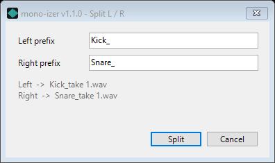

# mono-izer

Right-click a stereo `.wav` or `.mp3` on Windows → **mono-izer** → **Make mono (left channel)** or **Split L / R...**. The new files appear next to the original.

> **Platform:** Windows only. It uses Windows shell integration and ffmpeg.

## Make mono (left channel)

| Before: stereo (left + right) | After: mono (left only) |
|---|---|
|  |  |

- **Keeps the left channel and removes the right.** It does not mix the two channels, so the level does not change.
- **Nothing else changes.** Sample rate and bit depth stay the same. A 48 kHz 24-bit WAV becomes a 48 kHz 24-bit mono WAV. Tags are copied.
- **WAV is lossless.** The output uses the same PCM format as the source, so the mono file is bit-for-bit identical to the source's left channel.
- **MP3 is re-encoded once.** An MP3 cannot be edited without re-encoding. The output keeps the source bitrate, sample rate, tags and cover art.
- **The original is never modified.** The output is `<name>_mono.wav` or `<name>_mono.mp3`. If that name exists, it uses `_mono_2`, `_mono_3` and so on. Nothing is overwritten.
- **Mono files are skipped.**
- **Many files at once.** Select any number of files and right-click once. They are converted one at a time, at low priority, so a large batch does not slow down other work.
- **Errors** appear in one dialog at the end of the batch. Each result is written to `mono-izer.log` in the install folder.

## Split L / R

For a stereo file that holds two separate sources, such as two microphones recorded to the left and right channels.



- **Two mono files per source file.** The left channel goes to `<left prefix><name>`, the right channel to `<right prefix><name>`. With the prefixes above, `take 1.wav` becomes `Kick_take 1.wav` and `Snare_take 1.wav`.
- **One dialog per batch.** Select any number of files and pick **Split L / R...** once. The dialog asks for the two prefixes once, and every selected file uses them.
- **The prefixes are remembered.** The defaults are `L_` and `R_`. The dialog fills in the last prefixes you used.
- **Both prefixes are required, and they must be different.** Otherwise the two files would get the same name. Characters that Windows does not allow in file names (`\ / : * ? " < > |`) are refused.
- **Same quality rules as mono.** Each channel is copied as-is. WAV stays lossless and keeps its sample rate and bit depth. MP3 is re-encoded once at the source bitrate. Tags are copied.
- **The original is never modified, and nothing is overwritten.** If a name exists, `_2`, `_3` and so on is added. If the right channel fails, the left file is removed too, so a split is always both files or none.
- **Cancel** closes the dialog and changes nothing. Mono files are skipped.
## Install

**One click:** Download **[MonoIzer-Install.exe](../../releases/latest/download/MonoIzer-Install.exe)** and run it. No admin required. The installer (Inno Setup, per-user) is code-signed by Yuval Olsha, runs no scripts, and adds a normal uninstall entry in Settings > Apps.

**Manual:** Clone the repo, right-click `install.ps1` → Run with PowerShell. It compiles the launcher with the in-box C# compiler and registers the menu entry.

## Requirements

- ffmpeg and ffprobe — [gyan.dev/ffmpeg/builds](https://www.gyan.dev/ffmpeg/builds/)

The installer handles this. A copy already on your PATH is used as-is. If ffmpeg is missing, the installer downloads it (about 35 MB) from [GyanD/codexffmpeg](https://github.com/GyanD/codexffmpeg) (gyan.dev's own mirror), checks its SHA-256, puts it in `%LOCALAPPDATA%\Programs\DVLCE\ffmpeg` and adds that folder to your user PATH. [FFmpeg Convert](https://github.com/toyuvalo/ffmpeg-context-menu), [Shrink Menu](https://github.com/toyuvalo/shrink-menu) and [Doc Convert](https://github.com/toyuvalo/doc-convert-menu) use the same shared folder, so ffmpeg is downloaded once. Uninstalling removes the shared copy only when no other of these tools still needs it.

## How it works

`MonoIzer.exe` is a small compiled launcher. Explorer starts one launcher per selected file; the first one collects the whole selection and starts `mono-izer.ps1` once with the list (`MonoIzer.exe --split` for Split L / R). The script runs this for each file:

```
ffmpeg -i in.wav -map 0:a:0 -map_metadata 0 -af channelmap=map=0:channel_layout=mono -c:a <source codec> in_mono.wav
```

Split runs it twice, with `map=0` (left) and `map=1` (right). `channelmap` copies one channel without converting the sample format.

## Uninstall

Settings > Apps > mono-izer > Uninstall. For a manual install, run `uninstall.ps1` with PowerShell. Both remove the menu and the remembered prefixes.

## Build the exe yourself

```cmd
set NOSIGN=1
build.cmd
```

Requires Inno Setup 6 (`winget install JRSoftware.InnoSetup`). The launcher is compiled with the in-box C# compiler. Release builds are signed with Azure Artifact Signing through an `azsign.cmd` helper (set `AZSIGN` to its path); `NOSIGN=1` builds unsigned. ImageMagick on PATH regenerates the icon.

## More tools like this

Built by [dvlce.ca](https://dvlce.ca) — see [webdev.dvlce.ca](https://webdev.dvlce.ca) for the full project showcase.

## License

MIT with [Commons Clause](https://commonsclause.com/) — free to use, modify, and share. Commercial resale not permitted.
